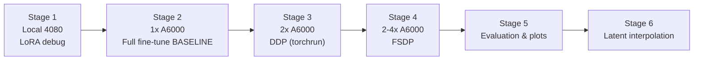

# Distributed Fine-Tuning of Stable Diffusion 1.5 — A Learning Project

Fine-tuning **Stable Diffusion 1.5** on the **`lambdalabs/pokemon-blip-captions`**
dataset as a vehicle for learning **distributed training in PyTorch** (DDP → FSDP).

> **Primary goal: understand distributed-training mechanics.** Fine-tuned model
> quality is explicitly *secondary* to the learning experience. Every design
> decision below is optimized for *visibility into the plumbing*, not for the
> prettiest Pokémon.

---

## 1. Motivation & Scope (the re-purposed brief)

| Aspect | Decision | Why |
|---|---|---|
| **Model** | SD 1.5 via Hugging Face `diffusers` (UNet / VAE / scheduler) | The diffusion loop must be *reliable* so bugs I hit are distributed-training bugs, not noise-schedule bugs |
| **Dataset** | `lambdalabs/pokemon-blip-captions` (~800 images) | Small and fast to iterate |
| **Training type** | **FULL UNet fine-tune** (not LoRA) for the real runs | Deliberately induce single-GPU memory pressure so **FSDP sharding is meaningful**, not just DDP on an already-tiny model. LoRA is a later cheap comparison |
| **Local HW** | RTX 4080 (16 GB) — **debug only** | Full fine-tune won't fit in 16 GB → local runs use **LoRA + reduced config** to catch bugs before spending cloud money |
| **Cloud HW** | Lambda Labs A6000 (48 GB), 1→4 GPUs | On-demand; budget ~$150–200 |

### Learning path / milestones



1. **Local 4080** — debug correctness (data loading, captions, loop runs) with LoRA / reduced config.
2. **1× A6000** — true single-GPU **full fine-tune baseline** (reference loss curves & speed). ← **this repo covers stages 1–2**
3. **2× A6000** — convert to **DistributedDataParallel** (`torchrun`, `DistributedSampler`); confirm loss matches baseline, observe speedup.
4. **2–4× A6000** — convert to **FullyShardedDataParallel**; compare memory footprint & speed vs DDP.
5. **Evaluation** — side-by-side comparison plots (below).
6. **Finale** — latent-space interpolation between prompts (inference only); stretch: img2img / style transfer.

---

## 2. Repository Layout

```
stable diffusion/
├── requirements.txt
├── train_baseline.py          # Stage-2 entry point (single-GPU baseline)
└── sdtrain/                    # Reusable package — UNCHANGED across DDP/FSDP stages
    ├── __init__.py
    ├── config.py               # local_debug / cloud_full presets (dataclass)
    ├── dist_utils.py           # rank helpers — already rank-0 aware
    ├── logging_utils.py        # CSVLogger + optional W&B + GPU-mem probes
    ├── data.py                 # pokemon-blip-captions pipeline (+ DistributedSampler hook)
    ├── models.py               # load SD1.5, freeze VAE/text-enc, LoRA-or-full UNet
    └── samples.py              # fixed-prompt classifier-free-guidance sampling grid
```

**Key architectural bet:** only the *entry script* changes between stages 2→3→4.
The `sdtrain/` package (data, model, logging, sampling, rank helpers) is written
once, correctly, and reused. That is what lets the DDP/FSDP conversions be small,
readable diffs — which is the whole point of the exercise.

---

## 3. Design Decisions & Reasoning (the "why", in detail)

### 3.1 No `accelerate` / no Trainer abstraction — manual AMP + manual optimizer loop
`diffusers` ships an `accelerate`-based `train_text_to_image.py`. I intentionally
**did not** use it. `accelerate` hides exactly the mechanics I am trying to learn:
device placement, gradient synchronization, `DistributedSampler.set_epoch`, the
rank-0 logging guard, and the FSDP wrapping policy. Writing the loop by hand in
[`train_baseline.py`](train_baseline.py) means the DDP/FSDP diffs will *show* the
distributed primitives instead of burying them behind a config flag.

### 3.2 The rank-0 pattern is wired in from step one
[`sdtrain/dist_utils.py`](sdtrain/dist_utils.py) returns rank `0` / world-size `1`
today (no `torch.distributed` initialized), and returns *real* values the moment
`torchrun` initializes the process group — **without changing call sites**:

```python
def is_dist_initialized():  return dist.is_available() and dist.is_initialized()
def get_rank():             return dist.get_rank() if is_dist_initialized() else 0
def get_world_size():       return dist.get_world_size() if is_dist_initialized() else 1
def is_main_process():      return get_rank() == 0
```

Every disk write in the training loop (CSV row, sample grid, checkpoint) is guarded
by `if main_process:`. Getting this right — *exactly one* process writes *exactly
one* row per step — is itself part of the distributed lesson. See the guards in
[`train_baseline.py`](train_baseline.py#L279-L320).

### 3.3 The `DistributedSampler` hook already exists
[`sdtrain/data.py`](sdtrain/data.py#L63-L75) branches on `world_size`: single-GPU
uses `shuffle=True` and no sampler; multi-GPU swaps in `DistributedSampler(...,
num_replicas=world_size, rank=rank)`. The training loop calls `sampler.set_epoch(epoch)`
each epoch via [`infinite_loader`](train_baseline.py#L133-L142) so shuffling differs
per epoch per rank. Nothing else in the loop changes.

### 3.4 Precision strategy — mixed dtype on purpose
- **Frozen** VAE + text encoder → cast to the low-precision `weight_dtype`
  (`bf16` by default) to save memory. They only ever run forward.
- **Trainable** UNet → kept in **fp32** master weights; the fast math happens
  inside `torch.autocast`. Full fine-tunes are numerically happier with fp32
  master weights + autocast than with pure fp16 parameters.
- **Loss** computed in fp32 (`model_pred.float()` vs `target.float()`) regardless
  of autocast dtype — see [`compute_loss`](train_baseline.py#L145-L187).
- **bf16 over fp16** for the A6000 (Ampere): bf16 has fp32's exponent range, so it
  needs **no `GradScaler`** and won't silently over/underflow. The fp16 +
  `GradScaler` path still exists (`--mixed_precision fp16`) and is handled by the
  `use_scaler` branch: `scaler.unscale_(optimizer)` before gradient clipping so the
  reported `grad_norm` is in real (unscaled) units.

### 3.5 Manual classifier-free-guidance sampling loop (not the pipeline)
[`sdtrain/samples.py`](sdtrain/samples.py) runs the text→image denoising loop by
hand instead of instantiating a `StableDiffusionPipeline`. Two reasons:
1. **Transparency** — the CFG loop is visible and matches what I'd write at inference.
2. **Dtype robustness** — during training the UNet is fp32 while VAE/text-encoder
   are bf16; a stock pipeline's internal `.to(dtype)` assumptions fight that mix.
   Wrapping the loop in `autocast` lets each op cast its own inputs. A
   `DPMSolverMultistepScheduler` (fast, ~25 steps) is used for sampling while
   `DDPMScheduler` (1000 steps) drives *training* noising.

### 3.6 Logging backend — CSV as source of truth, W&B optional
See §5 for the full tradeoff. Short version: **CSV is primary** (offline, zero-dep,
crash-survivable, trivially overlaid in stage 5); **W&B is strictly additive**
(`--use_wandb`) for live curves during long cloud runs.

---

## 4. The Diffusion Training Step (math ↔ code)

Implemented in [`compute_loss`](train_baseline.py#L145-L187). One optimizer step:

1. **Encode image → latent** (frozen VAE), scale to unit-ish variance:

$$z_0 = \text{VAE}_{\text{enc}}(x)\ \cdot\ s,\qquad s = 0.18215$$

   ```python
   latents = vae.encode(pixel_values).latent_dist.sample() * vae.config.scaling_factor
   ```

2. **Forward diffusion** — sample noise $\epsilon$ and a random timestep $t$, add noise:

$$z_t = \sqrt{\bar\alpha_t}\, z_0 + \sqrt{1-\bar\alpha_t}\,\epsilon,\qquad t \sim \mathcal{U}\{0, 999\}$$

   ```python
   noise = torch.randn_like(latents)
   timesteps = torch.randint(0, noise_scheduler.config.num_train_timesteps, (bsz,))
   noisy_latents = noise_scheduler.add_noise(latents, noise, timesteps)
   ```

3. **Text conditioning** (frozen CLIP text encoder): `encoder_hidden_states = text_encoder(input_ids)[0]`.

4. **Predict & compute loss** — SD1.5 uses **ε-prediction** (the code also handles
   `v_prediction` for generality):

$$\mathcal{L} = \mathbb{E}_{z_0,\epsilon,t}\big[\,\lVert \epsilon_\theta(z_t, t, c) - \epsilon \rVert_2^2\,\big]$$

   ```python
   model_pred = unet(noisy_latents, timesteps, encoder_hidden_states).sample
   loss = F.mse_loss(model_pred.float(), target.float())   # target = noise for epsilon
   ```

Only $\theta$ (UNet, or its LoRA adapters) receives gradients; VAE and text encoder
are frozen in [`models.py`](sdtrain/models.py#L33-L36).

---

## 5. Metrics Tracked

### 5.1 Why CSV + optional W&B
- **CSV is the source of truth.** Zero external deps, fully offline, survives a
  killed Lambda instance (each row is flushed immediately), and — decisively for
  stage 5 — lets me load `baseline/metrics.csv`, `ddp/metrics.csv`,
  `fsdp/metrics.csv` and overlay them with matplotlib. It's also trivial to reason
  about when the lesson is literally "did rank 0 write exactly one row per step?".
- **W&B is additive only** (`--use_wandb`). Nice for *live* curves during a long
  cloud run, but it needs an account/network and hides more plumbing than I want
  while learning. Every metric still goes to CSV; W&B just mirrors it.

### 5.2 Per-optimizer-step metrics (one CSV row per step)
Written by [`CSVLogger`](sdtrain/logging_utils.py#L38-L54); columns defined in
[`CSV_FIELDS`](train_baseline.py#L45-L54); assembled in the training loop at
[`train_baseline.py`](train_baseline.py#L288-L299).

| CSV column | Symbol / formula | Source | What it tells me |
|---|---|---|---|
| `step` | global optimizer step | loop counter | x-axis for every plot |
| `epoch` | passes over the ~800-image set | `infinite_loader` | context for loss dips |
| `loss` | $\frac{1}{A}\sum \mathcal{L}_{\text{micro}}$ (A = accum steps) | `accum_loss / accum` | learning signal; **must match across baseline/DDP/FSDP** |
| `lr` | current LR incl. warmup | `lr_scheduler.get_last_lr()[0]` | verify warmup + LR scaling when GPU count changes |
| `grad_norm` | $\lVert g \rVert_2$ **pre-clip** | `clip_grad_norm_(...)` return | sanity-check gradient **sync** across ranks |
| `step_time_s` | wall-clock/optimizer step | `time.perf_counter()` around a synced step | raw speed |
| `images_per_sec` | $\frac{B \cdot A \cdot W}{\Delta t}$ | computed each step | **throughput** — the DDP speedup metric |
| `peak_mem_mb` | `torch.cuda.max_memory_allocated / 2^20` | [`peak_memory_mb`](sdtrain/logging_utils.py#L72-L76) | **the FSDP payoff metric** |

where $B$ = `train_batch_size`, $A$ = `gradient_accumulation_steps`, $W$ =
`world_size`. Timing uses `torch.cuda.synchronize()` before measuring so async
CUDA kernels don't make steps look artificially fast.

### 5.3 Interval artifacts (not per-step)
| Artifact | Cadence | Code | Purpose |
|---|---|---|---|
| **Fixed-prompt sample grid** (4 prompts, fixed seed `1234`) | every `sample_every` | [`generate_samples`](sdtrain/samples.py#L44-L120) → `samples/samples_stepNNNNNN.png` | qualitative progress, comparable across steps *and* runs |
| **Checkpoint** (LoRA `.pt` or full UNet) | every `checkpoint_every` | [`save_checkpoint`](train_baseline.py#L190-L200) | resume / evaluation / interpolation source |
| **`config.json`** | run start | [`TrainConfig.to_json`](sdtrain/config.py#L96-L98) | run provenance |

### 5.4 Not yet tracked
- **CLIP score** (image↔prompt alignment trend) — optional stage-5 quantitative
  metric; deferred to the evaluation script.

---

## 6. Planned Visualizations (Stage 5)

Each plot maps directly to a tracked metric. All read the three `metrics.csv`
files (baseline / DDP / FSDP) plus the saved sample grids.

| Plot | Type | Source metric(s) | What "correct" looks like |
|---|---|---|---|
| **Loss curves overlaid** | line, `loss` vs `step`, one line per run | `loss` | DDP/FSDP curves **track the baseline** — sanity check that gradient averaging is right |
| **Throughput comparison** | grouped **bar** (and line vs GPU count) | `images_per_sec` | single < DDP-2 < DDP-4; FSDP slightly below DDP at equal GPUs (comms overhead) |
| **Peak-memory comparison** | **bar** chart, per-run `max(peak_mem_mb)` | `peak_mem_mb` | **FSDP well below DDP** — this is the plot that justifies sharding |
| **LR schedule** | line, `lr` vs `step` | `lr` | warmup ramp then cosine decay; confirms effective-batch / LR scaling |
| **Gradient-norm trend** | line, `grad_norm` vs `step` | `grad_norm` | comparable magnitude across runs ⇒ gradient sync behaving |
| **Sample grid across runs** | image montage at **matched steps** | `samples/*.png` | quality not sacrificed by DDP/FSDP |
| **CLIP-score trend** *(optional)* | line vs `step` | (to be added) | rising alignment over training |

Implementation note for stage 5: because every run writes an identical CSV schema,
the plotting script is a straight `pandas.read_csv` per run + matplotlib overlay —
no per-run special-casing.

---

## 7. Configuration Modes

Defined in [`sdtrain/config.py`](sdtrain/config.py) as a `TrainConfig` dataclass
with two factory presets. Override any field from the CLI (e.g. `--max_train_steps`).

| Field | `local_debug` (RTX 4080) | `cloud_full` (A6000) | Rationale |
|---|---|---|---|
| `finetune_mode` | `lora` | `full` | LoRA fits 16 GB; full induces the memory pressure FSDP solves |
| `resolution` | 256 | 512 | small/fast locally; native SD1.5 in cloud |
| `train_batch_size` | 1 | 4 | fit vs throughput |
| `max_train_steps` | 100 | 3000 | optimizer steps, **not** epochs — see §7.1 |
| `learning_rate` | 1e-4 | 1e-5 | LoRA tolerates higher LR; full fine-tune needs lower |
| `lr_scheduler` | `constant_with_warmup` | `cosine` | — |
| `lr_warmup_steps` | 10 | 300 | — |
| `mixed_precision` | `bf16` | `bf16` | no GradScaler; Ampere/Ada native |
| `gradient_checkpointing` | on | on | trade compute for memory |
| `num_workers` | 0 | 4 | 0 avoids Windows multiprocessing issues locally |
| `sample_every` / `checkpoint_every` | 50 / 100 | 250 / 500 | — |

Model repo defaults to `stable-diffusion-v1-5/stable-diffusion-v1-5` (the community
re-upload; the original `runwayml/...` repo was removed from the Hub).

### 7.1 `max_train_steps` is not the same as epochs

An **epoch** = one full traversal of all ~833 images. A **step** = one optimizer
update, consuming `train_batch_size` images. The relationship is:

$$\text{steps per epoch} = \left\lfloor \frac{N_{\text{dataset}}}{B \cdot A} \right\rfloor$$

where $B$ = `train_batch_size`, $A$ = `gradient_accumulation_steps`.

| Mode | Dataset $N$ | Batch $B$ | Accum $A$ | Steps / epoch | `max_train_steps` | Epochs completed |
|---|---|---|---|---|---|---|
| `local_debug` | 833 | 1 | 1 | **833** | 100 | **0.12** — never finishes one epoch |
| `cloud_full` | 833 | 4 | 1 | **208** | 3000 | **~14.4** |

`local_debug` at 100 steps sees only 12 % of the dataset *once* — intentional,
because the goal is pipeline correctness, not actual learning. `cloud_full` at
3000 steps sees the data ~14 times, a reasonable number for fine-tuning on ~800 images.

The training loop uses [`infinite_loader`](train_baseline.py) — the dataloader
cycles forever and is terminated by `max_train_steps`, **not** by epoch boundaries.
The `epoch` counter increments naturally when the dataloader exhausts one pass and
is logged in `metrics.csv` purely for context (e.g. to understand loss dips that
coincide with a new epoch starting):

```python
def infinite_loader(dataloader, sampler):
    epoch = 0
    while True:                          # never stops on its own
        if sampler is not None:
            sampler.set_epoch(epoch)     # re-shuffles each pass for DDP/FSDP
        for batch in dataloader:
            yield epoch, batch
        epoch += 1                       # incremented only after a full pass

# outer loop — the only real termination condition
while global_step < cfg.max_train_steps:
    ...
```

---

## 8. How to Run

```powershell
pip install -r requirements.txt

# Stage 1 — local correctness check on the RTX 4080 (LoRA, 256px, 100 steps)
python train_baseline.py --mode local_debug

# Stage 2 — true baseline on a Lambda A6000 (full UNet, 512px, 3000 steps)
python train_baseline.py --mode cloud_full

# Optional live dashboard
python train_baseline.py --mode cloud_full --use_wandb --run_name a6000-baseline
```

**First-run smoke checks:**
1. Dataset downloads; captions tokenize; first few `loss` values are finite (~0.1–0.2).
2. A sample grid appears at `outputs/<run>/samples/` by the first `sample_every` step.

### Output layout
```
outputs/<run>/
├── config.json                     # exact config used
├── metrics.csv                     # one row per optimizer step (§5.2)
├── samples/samples_stepNNNNNN.png  # fixed-prompt grids
└── checkpoint-NNNNNN/              # unet_lora.pt  (LoRA)  |  unet/  (full)
```

---

## 9. Distributed Roadmap (what actually changes next)

Because the heavy lifting lives in `sdtrain/`, each conversion is a small diff on
the *entry script* only.

### Stage 3 — DDP (`torchrun --nproc_per_node=2 train_ddp.py`)
- `dist.init_process_group("nccl")`; `torch.cuda.set_device(local_rank)`.
- `unet = DistributedDataParallel(unet, device_ids=[local_rank])`.
- `build_dataloader(..., world_size, rank)` → activates the existing
  `DistributedSampler` branch; `set_epoch` already wired.
- **Loss/rank-0 logging unchanged** — the guards already exist.
- **LR scaling check:** effective batch = $B \cdot A \cdot W$; the logged `lr` and
  `grad_norm` columns are the sanity check that scaling was handled.

### Stage 4 — FSDP
- Replace DDP wrap with `FullyShardedDataParallel` + a transformer
  `auto_wrap_policy` on the UNet blocks; `MixedPrecision(param/reduce/buffer=bf16)`.
- Compare `peak_mem_mb` (should drop sharply) and `images_per_sec` (slight comms
  cost) against the DDP run using the identical CSV schema.

### Stage 6 — Finale
- Latent-space interpolation between two prompts using a saved
  `checkpoint-NNNNNN` (inference only). Stretch: img2img / style transfer from the
  same checkpoint.

---

## 10. Dependencies

See [`requirements.txt`](requirements.txt): `torch`, `torchvision`, `diffusers`,
`transformers`, `peft` (LoRA), `datasets`, `Pillow`, `tqdm`, `matplotlib`
(stage-5 plots). `wandb` is optional and only imported when `--use_wandb` is set.
